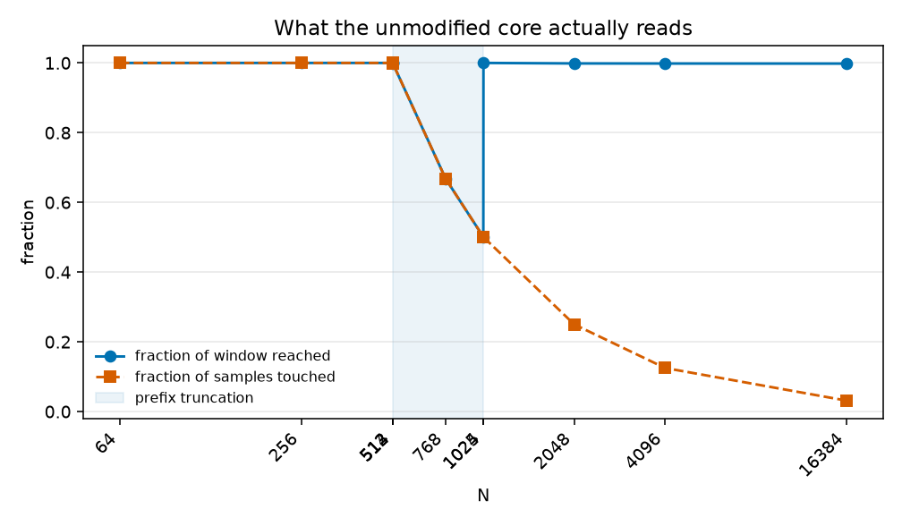
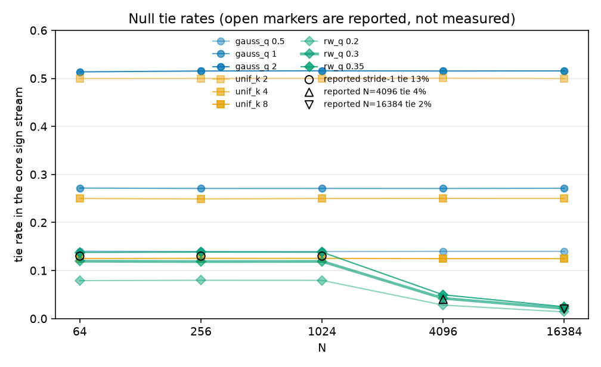
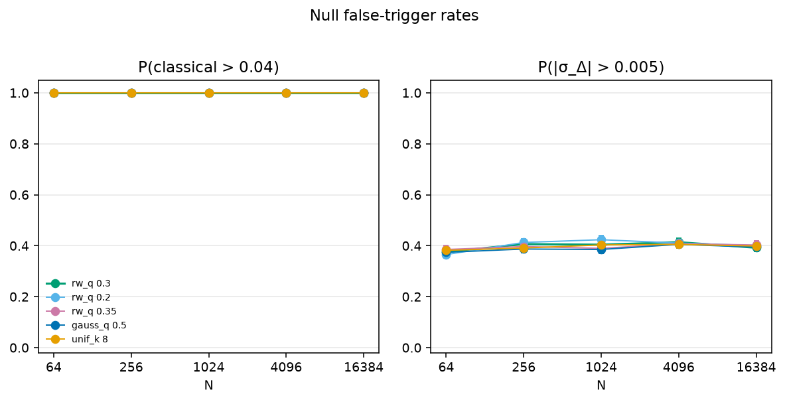
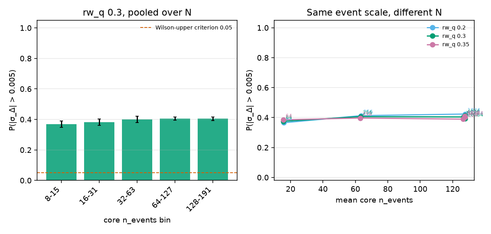
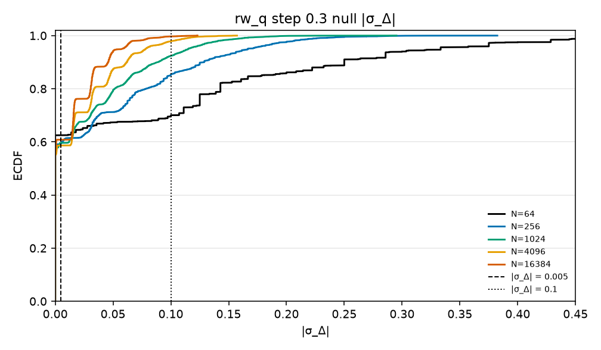
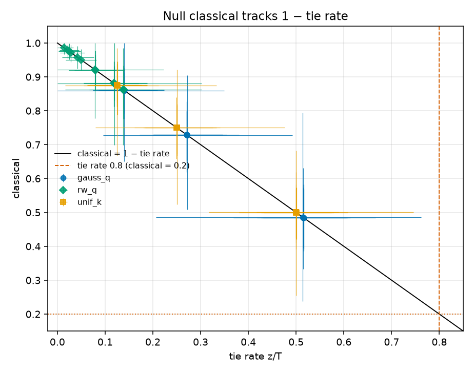

# Job 2 — threshold bounds, Monte Carlo null half

Null-only calibration of the locked Dual Residual core. The core header, the decision table, and the constants `0.04 / 0.005 / 0.1 / 0.2` are unchanged. No facade file was edited. No third signal was added on the public path.

This is not a real-data study. Reported MIT-BIH tie rates are used only as a target band for one null family. Nothing below is an ECG measurement, a negative control on labeled series, or a T2/T3 regime result.

## Code under test

| Item | Value |
|---|---|
| Locked core commit | `ba2ea5717863ae70497aed51514f9db2c0653b22` |
| `dual_residual.hpp` blob | `13d5c5913a4f26142f08725edd33c7c98b63a574` |
| Validation artifacts | `bad5e7729f341584edbb52fa18d4bfdf24d01f02` |
| Trials per cell | 4000 |
| Master seed | `0xD0A15EED20261123` |
| Trial CSV sha256 | `9eb5b929ce7a72498c9bcbc92a895d67c5df2d075fed9ffb9a13fa59d52d178b` |

The sweep calls `dual_residual::evidence` and `dual_residual::detail::compute` in the unmodified header. It does not use `public_null_calibration.py`.

## 1. What the core actually does

The public entry is `dual_residual::evidence(a, n)`. It reads raw values. It builds a sign stream, then a classical score and `σ_Δ`, then the locked talent table.

### Sign stream

`polarity_stream_strided` walks `i = 0, stride, 2·stride, …` while `i + stride < n` and the sign count is below `max_out` (default `DUAL_RESIDUAL_MAX_EVENTS`, which is 512). Each step compares the pair `(a[i], a[i+stride])` and writes `+1`, `-1`, or `0`.

That is a comparison of successive points on the stride lattice. It is not a sliding comparison of every index with the sample a stride ahead. For stride 1 the two descriptions coincide, and the 512-sign cap still stops the walk early.

### Stride

```128:131:dual_residual.hpp
    size_t stride = (n > 1024) ? (n / SAMPLE_SIZE) : 1;
    if (stride < 1) stride = 1;
    int Tlen = detail::polarity_stream_strided(a, n, stride, stream,
        (int)std::min(max_events, (size_t)DUAL_RESIDUAL_MAX_EVENTS));
```

`SAMPLE_SIZE` is 512. For `n ≤ 1024`, stride is 1. For `n > 1024`, stride is `n / 512` in integer arithmetic. The claim “for N > 1024 the stride becomes N/512” is true.

### Which indices are read

A probe type whose `operator>` / `operator<` record every index was passed through unmodified `evidence()`. The touch set matches the lattice: index `i` is read if and only if `i` is a multiple of the stride and `i ≤ T·stride`, with `T = min(512, floor((n−1)/stride))`.

`fraction_window_read = (last index read + 1) / N`. That is the fraction of the caller’s window the core reaches. `fraction_samples_touched = (number of distinct indices read) / N`.

| N | stride | signs T | last index | fraction of window read | samples touched |
|---:|---:|---:|---:|---:|---:|
| 64 | 1 | 63 | 63 | 1 | 1 |
| 256 | 1 | 255 | 255 | 1 | 1 |
| 512 | 1 | 511 | 511 | 1 | 1 |
| 513 | 1 | 512 | 512 | 1 | 1 |
| 514 | 1 | 512 | 512 | 513/514 = 0.9980544747 | 513/514 |
| 768 | 1 | 512 | 512 | 513/768 = 0.6679687500 | 513/768 |
| 1024 | 1 | 512 | 512 | 513/1024 = 0.5009765625 | 513/1024 |
| 1025 | 2 | 512 | 1024 | 1 | 513/1025 |
| 4096 | 8 | 511 | 4088 | 4089/4096 = 0.9982910156 | 512/4096 = 0.125 |
| 16384 | 32 | 511 | 16352 | 16353/16384 = 0.9981079102 | 512/16384 = 0.03125 |

At **N = 1024** the stride is 1, the core stops after 512 signs, and the indices it reads are `0…512`. That is the first 513 samples. The tail `513…1023` is never loaded. The half-window description is right at N = 1024.

The same mechanism covers **514 ≤ N ≤ 1024**: stride stays 1, and the core always stops at index 512, so the fraction read is `513/N`. At N = 514 that is one unread sample. At N = 768 it is the first two thirds. It is one half only when N is 1024.

**N = 512 and N = 513 are read in full.** At N = 513 the 512-sign cap and the end of the array land on the same comparison. For `512 < N ≤ 1024` as a blanket statement, “only the first half” is the N = 1024 case of a fixed 513-sample prefix.

For **N > 1024** the stride lattice is the locked decimation. The span reaches the last lattice point; a remainder shorter than one stride stays unread (`fraction_window_read > 1 − 1/512`). Samples between lattice points are skipped on purpose. N = 1025 already has span fraction 1, at stride 2.



### Events

`detail::compute` flags a crossing when `stream[t] > 0` flips. A `+1` is above the cut. Both `0` and `−1` are not. So:

- `+1 ↔ −1` and `+1 ↔ 0` are events
- `−1 ↔ 0` and a run of zeros are not events

There is no separate zero-dwell event. Zeros sit on the non-positive side of a one-sided cut.

Only even indices of that crossing list are kept. `σ_Δ` is the difference between the even-slot and odd-slot means of the stream values at those kept times. `Sigma::n_events` is that kept count, which is `(n_crossings + 1) / 2` when there are at least 4 crossings, and 0 otherwise. The tables below use that field as the event count. Raw crossings are about twice as large and are capped by the sign length (at most 511), so the 512-slot event array inside `compute` does not bind on its own.

On a tie-free `±1` stream the kept values are constant and `σ_Δ` is 0. The harness checks this identity on every trial: `n_events` matches the crossing count, and `evidence().sigma_delta` matches `detail::compute`.

### Decision table, as executed

`classical > 0.04` and `|σ_Δ| ≥ 0.005` own the path (`|σ_Δ| < 0.005` refuses). Owned and `|σ_Δ| > 0.1` is T2. Otherwise owned and `classical > 0.2` is T3. Otherwise owned is T1. Unowned is None.

Across 180,000 null trials, `|σ_Δ| > 0.005` and `|σ_Δ| ≥ 0.005` selected the same rows. No trial landed on the float atom at `0.005f`.

## 2. Null design

Fixed seeds. Trial seed is splitmix64 of the master seed, family, step, N, and trial index. Gaussian draws are Box–Muller from that stream (host libm). Re-running the two 10-trial copies in `run_job2_null_sweep.sh` is a byte match (`cmp`).

| Family | Step | Law |
|---|---|---|
| `gauss_q` | 0.5, 1, 2 | iid `llround(Normal(0,1) / step)` |
| `unif_k` | 2, 4, 8 | iid uniform on `{0,…,K−1}` |
| `rw_q` | 0.2, 0.3, 0.35 | unit Gaussian random walk, 4096-step burn-in, position `llround(S / step)` |

N ∈ {64, 256, 1024, 4096, 16384}. Nine series × five lengths × 4000 trials.

`rw_q` steps were locked from tie rates only, before any false-trigger rate was computed. The score against the reported contract figures (13% at stride 1, 4% at N = 4096, 2% at N = 16384) picks step 0.3, with candidate neighbors 0.2 and 0.35. See `select_rw_step.py` and `data/pilot_tie_rates.csv`.

Measured tie rates for **`rw_q` step 0.3**, the family whose ties span roughly 2–15%:

| N | stride | tie rate |
|---:|---:|---:|
| 64 | 1 | 0.1194 |
| 256 | 1 | 0.1186 |
| 1024 | 1 | 0.1190 |
| 4096 | 8 | 0.0422 |
| 16384 | 32 | 0.0211 |

The iid families hold a flat tie rate (about 0.14, 0.27, 0.51 for the Gaussian steps; 0.50, 0.25, 0.125 for alphabets 2, 4, 8). Alphabet 8 and Gaussian step 0.5 sit near the stride-1 end of the same band and do not fall as N grows.



Open markers on that figure are the reported contract figures. They were not measured in this repository.

## 3. Headline null false-trigger rates

Focus family `rw_q` step 0.3. Wilson intervals are 95%. “Fraction of window read” is `(last index + 1) / N`.

| N | window read | tie rate | events | P(C > 0.04) | P(\|σ_Δ\| > 0.005) | Wilson 95% | P(owned) | None | T1 | T2 | T3 | P(σ_Δ = 0) | refusal given σ_Δ = 0 |
|---:|---:|---:|---:|---:|---:|---|---:|---:|---:|---:|---:|---:|---:|
| 64 | 1 | 0.1194 | 15.61 | 1 | 0.3752 | [0.3604, 0.3904] | 0.3752 | 0.6248 | 0 | 0.3025 | 0.0727 | 0.6248 | 1 |
| 256 | 1 | 0.1186 | 63.14 | 1 | 0.4062 | [0.3911, 0.4216] | 0.4062 | 0.5938 | 0 | 0.1475 | 0.2587 | 0.5905 | 1 |
| 1024 | 0.5009765625 | 0.1190 | 126.66 | 1 | 0.4040 | [0.3889, 0.4193] | 0.4040 | 0.5960 | 0 | 0.0767 | 0.3272 | 0.5780 | 1 |
| 4096 | 0.9982910156 | 0.0422 | 127.58 | 1 | 0.4138 | [0.3986, 0.4291] | 0.4138 | 0.5863 | 0 | 0.0220 | 0.3917 | 0.5510 | 1 |
| 16384 | 0.9981079102 | 0.0211 | 127.70 | 1 | 0.3920 | [0.3770, 0.4072] | 0.3920 | 0.6080 | 0 | 0.0035 | 0.3885 | 0.5670 | 1 |

`P(owned)` equals `P(|σ_Δ| > 0.005)` in every cell of the grid, because `classical > 0.04` on every trial. Refusal given `σ_Δ == 0` exactly is 1 in every cell that has such trials. Those zeros are computed cancellations (`n_events > 0` on all of them). The early return for fewer than 4 crossings did not occur in this grid.

Across all 45 cells, `P(classical > 0.04) = 1`. `P(|σ_Δ| > 0.005)` runs from 0.2198 (`gauss_q` step 2, N = 64) to 0.4235 (`rw_q` step 0.2, N = 1024). No cell has a Wilson upper bound at or below 0.05.



Full per-cell state rates, event means, and both sigma predicates are in `data/summary_by_cell.csv`.

## 4. `|σ_Δ| > 0.005` against event count

On the focus family the logistic fit of `P(|σ_Δ| > 0.005)` on `log(n_events)`, pooling all five lengths (20,000 trials with `n_events ≥ 2`), is

`logit(p) = −0.652 + 0.056 · log(n_events)`

with mean rate 0.398. The slope is slightly positive. The rate does not fall as the event count grows.

Binned rates for `rw_q` step 0.3:

| n_events | trials | P(\|σ_Δ\| > 0.005) | Wilson 95% | Wilson upper ≤ 0.05 |
|---|---:|---:|---|---:|
| 8–15 | 1928 | 0.3688 | [0.3475, 0.3906] | no |
| 16–31 | 2072 | 0.3813 | [0.3606, 0.4024] | no |
| 32–63 | 2132 | 0.4001 | [0.3795, 0.4211] | no |
| 64–127 | 8016 | 0.4048 | [0.3941, 0.4156] | no |
| 128–191 | 5852 | 0.4043 | [0.3918, 0.4169] | no |

The same is true of the pooled `rw_q` bins and of the all-family bins that have at least 200 trials. The pre-set bound used here is a Wilson 95% upper bound of 0.05. No occupied bin meets it. The core cannot emit more than 256 kept events (`n_events ≤ 256`).

Inside N ∈ {1024, 4096, 16384} the focus family’s mean event count stays at 126.7–127.7 while the tie rate falls from 0.119 to 0.021 and N grows by 16×. `P(|σ_Δ| > 0.005)` stays inside [0.392, 0.414]. Event count does not explain that plateau, and the plateau does not move the 0.005 rate.

What does move with event count and with tie rate is the split of *owned* windows between T2 and T3. At N = 64 (`n_events ≈ 16`) most owned focus windows are T2 (`|σ_Δ| > 0.1`). At N = 16384 (`n_events ≈ 128`, tie rate 0.021) T2 is 0.0035 and almost every owned window is T3. That is the 0.1 gate, not a calibration of 0.005.





The mass of `|σ_Δ|` sits on a point at 0 and a shoulder that crosses both 0.005 and, at small N, 0.1. The 0.005 line is inside the shoulder at every N in the focus family.

## 5. Proposed facade guard (spec only)

Not implemented. `dual_residual_prod.hpp` and `dual_residual_relational.hpp` are untouched. Thresholds stay `0.04 / 0.005 / 0.1 / 0.2`. The guard adds no third signal and does not rewrite polarity, `σ_Δ`, or talent.

### 5.1 Coverage admission — the guard this sweep supports

The facade already receives `n`. Before the core call:

- If `514 ≤ n ≤ 1024`, return the zero `Evidence` (confirmed false, talent None, scores 0).

In that band the core’s stride is 1 and it reads only indices `0…512`. `fraction_window_read = 513/n`, which is 0.501 at n = 1024 and 0.998 at n = 514. The caller’s tail is invisible. A production guard should not certify that window.

Admit the complementary lengths:

- `n ≤ 513`: stride 1, the array is fully read (n = 512 uses 511 signs; n = 513 uses 512 signs and includes the last sample).
- `n ≥ 1025`: stride is `n/512`, the lattice reaches the end of the series up to a remainder shorter than one stride, and `fraction_window_read > 1 − 1/512`. That decimation is the locked cliff (`test_table_lock` says not to “fix” it). This guard does not refuse it and does not change the stride.

The relational facade only forwards to prod, so it would inherit the guard. No new field on `Evidence`.

### 5.2 Event count — no 0.005 bound inside the cap

There is no minimum or maximum event count in `0…256` at which `P(|σ_Δ| > 0.005)` has a Wilson 95% upper bound ≤ 0.05, on the focus family or on the grid as a whole.

An event-count admission rule would not make 0.005 a false-trigger bound for tie rates in the 2–15% band, nor for the heavier tie rates in this grid (up to about 0.76). `Evidence` does not carry `n_events`. Counting events in the facade would re-implement the crossing walk; this spec does not ask for that, and it would not be a new public signal even if a later change exposed the count as a private diagnostic.

N alone is also not an admission rule for the 0.005 rate. On the focus family the rate is about 0.39–0.41 at every official N, including the lengths whose window is fully read and the lengths whose stride has already cut the tie rate to about 2%.

## 6. Classical is one minus the tie rate

### Formula

The sign alphabet is exactly `{+1, −1, 0}`, so `|s_t|` is 0 on a tie and 1 otherwise. The core stores

```134:137:dual_residual.hpp
    float sum = 0.f;
    for (int i = 0; i < Tlen; ++i) sum += std::fabs(stream[i]);
    de.classical = sum / (float)Tlen;
```

With `z` ties in a sign stream of length `T`, the sum is the integer `T − z` (exact in float32 for `T ≤ 512`). The stored value is the float32 ratio

`classical = float32(T − z) / float32(T)`.

In real arithmetic that is `1 − z/T`. The float32 expression `1.f − float32(z)/float32(T)` matches the stored ratio bitwise when `T = 512`. On `T ∈ {63, 255, 511}` the two float32 expressions differ for many `z`, by at most one ulp (`5.960e-8`). `test_zero_necessity` already pins the Knuth form to within `1e-6`. This job pins the stored value to the ratio.

On all 180,000 null trials the printed `classical` matched `float32((T−z)/T)` with maximum absolute gap 0. The maximum gap versus `float32(1 − z/T)` was `5.960e-8`. Every constructed stream in `classical_t1_probe` likewise matched the ratio bitwise, or the probe would have exited.

### Distribution against the tie rate

Each cell is 4000 trials. Tie min–max is the range of `z/T`. Classical min–max is the range of the core’s float. `P(C > 0.2)` is the fraction of trials with `classical > 0.2`. Owned counts split into T2 and T3. T1 is the last column.

| family | step | N | T | tie mean | tie min–max | classical mean | classical min–max | P(C>0.2) | owned | T2 | T3 | T1 |
|---|---|---:|---:|---:|---|---:|---|---:|---:|---:|---:|---:|
| gauss_q | 0.5 | 64 | 63 | 0.1403 | 0.0000–0.3492 | 0.8597 | 0.6508–1.0000 | 1 | 1496 | 919 | 577 | 0 |
| gauss_q | 0.5 | 256 | 255 | 0.1396 | 0.0745–0.2235 | 0.8604 | 0.7765–0.9255 | 1 | 1548 | 410 | 1138 | 0 |
| gauss_q | 0.5 | 1024 | 512 | 0.1394 | 0.0898–0.2031 | 0.8606 | 0.7969–0.9102 | 1 | 1541 | 168 | 1373 | 0 |
| gauss_q | 0.5 | 4096 | 511 | 0.1399 | 0.0900–0.2055 | 0.8601 | 0.7945–0.9100 | 1 | 1621 | 192 | 1429 | 0 |
| gauss_q | 0.5 | 16384 | 511 | 0.1399 | 0.0861–0.2094 | 0.8601 | 0.7906–0.9139 | 1 | 1578 | 156 | 1422 | 0 |
| gauss_q | 1 | 64 | 63 | 0.2716 | 0.0952–0.4921 | 0.7284 | 0.5079–0.9048 | 1 | 1351 | 999 | 352 | 0 |
| gauss_q | 1 | 256 | 255 | 0.2708 | 0.1725–0.3804 | 0.7292 | 0.6196–0.8275 | 1 | 1361 | 538 | 823 | 0 |
| gauss_q | 1 | 1024 | 512 | 0.2709 | 0.1992–0.3457 | 0.7291 | 0.6543–0.8008 | 1 | 1365 | 257 | 1108 | 0 |
| gauss_q | 1 | 4096 | 511 | 0.2708 | 0.2016–0.3542 | 0.7292 | 0.6458–0.7984 | 1 | 1371 | 276 | 1095 | 0 |
| gauss_q | 1 | 16384 | 511 | 0.2712 | 0.2016–0.3464 | 0.7288 | 0.6536–0.7984 | 1 | 1403 | 290 | 1113 | 0 |
| gauss_q | 2 | 64 | 63 | 0.5135 | 0.2063–0.7619 | 0.4865 | 0.2381–0.7937 | 1 | 879 | 711 | 168 | 0 |
| gauss_q | 2 | 256 | 255 | 0.5152 | 0.3686–0.6667 | 0.4848 | 0.3333–0.6314 | 1 | 959 | 468 | 491 | 0 |
| gauss_q | 2 | 1024 | 512 | 0.5157 | 0.4180–0.6133 | 0.4843 | 0.3867–0.5820 | 1 | 933 | 317 | 616 | 0 |
| gauss_q | 2 | 4096 | 511 | 0.5152 | 0.4266–0.6047 | 0.4848 | 0.3953–0.5734 | 1 | 915 | 296 | 619 | 0 |
| gauss_q | 2 | 16384 | 511 | 0.5155 | 0.4305–0.6086 | 0.4845 | 0.3914–0.5695 | 1 | 926 | 288 | 638 | 0 |
| rw_q | 0.2 | 64 | 63 | 0.0790 | 0.0000–0.2222 | 0.9210 | 0.7778–1.0000 | 1 | 1461 | 1202 | 259 | 0 |
| rw_q | 0.2 | 256 | 255 | 0.0797 | 0.0235–0.1412 | 0.9203 | 0.8588–0.9765 | 1 | 1651 | 477 | 1174 | 0 |
| rw_q | 0.2 | 1024 | 512 | 0.0795 | 0.0352–0.1211 | 0.9205 | 0.8789–0.9648 | 1 | 1694 | 204 | 1490 | 0 |
| rw_q | 0.2 | 4096 | 511 | 0.0281 | 0.0059–0.0568 | 0.9719 | 0.9432–0.9941 | 1 | 1641 | 29 | 1612 | 0 |
| rw_q | 0.2 | 16384 | 511 | 0.0140 | 0.0000–0.0333 | 0.9860 | 0.9667–1.0000 | 1 | 1603 | 0 | 1603 | 0 |
| rw_q | 0.3 | 64 | 63 | 0.1194 | 0.0000–0.3016 | 0.8806 | 0.6984–1.0000 | 1 | 1501 | 1210 | 291 | 0 |
| rw_q | 0.3 | 256 | 255 | 0.1186 | 0.0549–0.1882 | 0.8814 | 0.8118–0.9451 | 1 | 1625 | 590 | 1035 | 0 |
| rw_q | 0.3 | 1024 | 512 | 0.1190 | 0.0684–0.1699 | 0.8810 | 0.8301–0.9316 | 1 | 1616 | 307 | 1309 | 0 |
| rw_q | 0.3 | 4096 | 511 | 0.0422 | 0.0098–0.0763 | 0.9578 | 0.9237–0.9902 | 1 | 1655 | 88 | 1567 | 0 |
| rw_q | 0.3 | 16384 | 511 | 0.0211 | 0.0039–0.0450 | 0.9789 | 0.9550–0.9961 | 1 | 1568 | 14 | 1554 | 0 |
| rw_q | 0.35 | 64 | 63 | 0.1379 | 0.0159–0.3016 | 0.8621 | 0.6984–0.9841 | 1 | 1541 | 1241 | 300 | 0 |
| rw_q | 0.35 | 256 | 255 | 0.1384 | 0.0667–0.2235 | 0.8616 | 0.7765–0.9333 | 1 | 1587 | 591 | 996 | 0 |
| rw_q | 0.35 | 1024 | 512 | 0.1382 | 0.0820–0.1934 | 0.8618 | 0.8066–0.9180 | 1 | 1558 | 346 | 1212 | 0 |
| rw_q | 0.35 | 4096 | 511 | 0.0495 | 0.0176–0.0822 | 0.9505 | 0.9178–0.9824 | 1 | 1631 | 109 | 1522 | 0 |
| rw_q | 0.35 | 16384 | 511 | 0.0246 | 0.0020–0.0489 | 0.9754 | 0.9511–0.9980 | 1 | 1611 | 20 | 1591 | 0 |
| unif_k | 2 | 64 | 63 | 0.4998 | 0.3175–0.7460 | 0.5002 | 0.2540–0.6825 | 1 | 938 | 723 | 215 | 0 |
| unif_k | 2 | 256 | 255 | 0.4999 | 0.3804–0.6078 | 0.5001 | 0.3922–0.6196 | 1 | 939 | 426 | 513 | 0 |
| unif_k | 2 | 1024 | 512 | 0.5000 | 0.4316–0.5742 | 0.5000 | 0.4258–0.5684 | 1 | 1039 | 268 | 771 | 0 |
| unif_k | 2 | 4096 | 511 | 0.5004 | 0.4266–0.5793 | 0.4996 | 0.4207–0.5734 | 1 | 1006 | 257 | 749 | 0 |
| unif_k | 2 | 16384 | 511 | 0.4997 | 0.4168–0.5890 | 0.5003 | 0.4110–0.5832 | 1 | 974 | 258 | 716 | 0 |
| unif_k | 4 | 64 | 63 | 0.2499 | 0.0794–0.4762 | 0.7501 | 0.5238–0.9206 | 1 | 1376 | 968 | 408 | 0 |
| unif_k | 4 | 256 | 255 | 0.2492 | 0.1608–0.3412 | 0.7508 | 0.6588–0.8392 | 1 | 1444 | 552 | 892 | 0 |
| unif_k | 4 | 1024 | 512 | 0.2500 | 0.1816–0.3262 | 0.7500 | 0.6738–0.8184 | 1 | 1414 | 254 | 1160 | 0 |
| unif_k | 4 | 4096 | 511 | 0.2501 | 0.1800–0.3327 | 0.7499 | 0.6673–0.8200 | 1 | 1360 | 244 | 1116 | 0 |
| unif_k | 4 | 16384 | 511 | 0.2501 | 0.1840–0.3327 | 0.7499 | 0.6673–0.8160 | 1 | 1364 | 286 | 1078 | 0 |
| unif_k | 8 | 64 | 63 | 0.1250 | 0.0159–0.3333 | 0.8750 | 0.6667–0.9841 | 1 | 1527 | 919 | 608 | 0 |
| unif_k | 8 | 256 | 255 | 0.1254 | 0.0549–0.2118 | 0.8746 | 0.7882–0.9451 | 1 | 1564 | 381 | 1183 | 0 |
| unif_k | 8 | 1024 | 512 | 0.1253 | 0.0820–0.1875 | 0.8747 | 0.8125–0.9180 | 1 | 1612 | 139 | 1473 | 0 |
| unif_k | 8 | 4096 | 511 | 0.1248 | 0.0626–0.1761 | 0.8752 | 0.8239–0.9374 | 1 | 1620 | 140 | 1480 | 0 |
| unif_k | 8 | 16384 | 511 | 0.1247 | 0.0763–0.1879 | 0.8753 | 0.8121–0.9237 | 1 | 1595 | 147 | 1448 | 0 |

Percentiles are in `data/classical_vs_tie.csv`. The lowest classical in the grid is 0.238095 (`15/63`), from `gauss_q` step 2 at N = 64, whose highest tie rate is `48/63 = 0.761905`. Mean classical equals `1 − mean tie rate` in every cell.



### Is T1 reachable?

The frozen branch is reachable. `compute_talent` returns T1 when the path is owned, `|σ_Δ| ≤ 0.1`, and `classical ≤ 0.2`. `test_table_lock` pins the corners: `(0.1, 0.1)`, `(0.2, 0.05)`, and `(0.0401, 0.005)` are T1; `(0.1, 0.1001)` is T2; `(0.2001, 0.05)` is T3.

Because `classical = (T − z) / T`, that classical window is a tie-rate window. Integer `z` for which float32`(T−z)/T` lies in `(0.04, 0.2]`:

| sign length T | where the core uses it | tie count z | tie rate | classical at the ends |
|---:|---|---|---|---|
| 63 | N = 64 | 51…60 | 0.809524…0.952381 | 0.190476 … 0.047619 |
| 255 | N = 256 | 204…244 | 0.800000…0.956863 | 0.200000 … 0.043137 |
| 512 | N = 1024 (prefix) and N = 513 (full) | 410…491 | 0.800781…0.958984 | 0.199219 … 0.041016 |
| 511 | N = 4096 and N = 16384 | 409…490 | 0.800391…0.958904 | 0.199609 … 0.041096 |

T1 also needs `0.005 ≤ |σ_Δ| ≤ 0.1`. Outside the tie-rate interval, T1 is impossible for any `σ_Δ`: below the interval, `classical > 0.2`, so an owned window is T2 if `|σ_Δ| > 0.1` and T3 otherwise; above the interval, `classical ≤ 0.04` and the path is not owned.

Unmodified `evidence()` does emit T1 on constructed sign streams inside that interval (not null draws, not recordings):

| N | T | tie rate | classical | σ_Δ | talent |
|---:|---:|---:|---:|---:|---|
| 64 | 63 | 0.857143 | 0.14285715 | +0.08333334 | T1 |
| 256 | 255 | 0.956863 | 0.04313726 | +0.05000000 | T1 |
| 512 | 511 | 0.958904 | 0.04109589 | +0.01111111 | T1 |
| 513 | 512 | 0.958984 | 0.04101562 | +0.01111111 | T1 |

Under the null families in this job, T1 does not occur. All 180,000 trials have `classical > 0.2` (minimum 0.238). Every owned window is T2 or T3, and the T2+T3 counts above add up to the owned count. The same conclusion covers the 2–15% tie band, including `rw_q` step 0.3 and the flat controls near 12–14% ties: classical sits between about 0.85 and 0.99, the `classical > 0.2` test is true on every trial, and an owned window cannot be T1.

A series whose sign-stream tie rate is the reported stride-1 figure of about 13%, or the reported 4% and 2% at the long lengths, would have classical about 0.87, 0.96, and 0.98 if this identity holds there. This job did not measure that series. On the nulls that match those tie rates, every owned window is T2 or T3.

## 7. Reproduce

From the repo root, on this image (g++ 13.3, glibc libm):

```bash
bash validation/job2_null_sweep/run_job2_null_sweep.sh
```

The script compiles the harness against the locked header, probes coverage, reprints the tie-rate pilot, checks that the locked `rw_q` steps match the pre-registered rule, checks that two short runs are byte-identical, runs the 4000-trial grid, runs the classical/T1 probe, writes the tables and plots, and refreshes `data/SHA256SUMS`.

Wall time on this machine was under a minute.

## 8. Existing tests

Re-run after this folder was added. The core and both facades were not edited.

| Suite | Result |
|---|---|
| `tests/test_evidence` | ALL GREEN |
| `tests/test_parity_oracle` | ALL GREEN |
| `tests/test_borderline_cases` | ALL GREEN |
| `tests/test_table_lock` | ALL GREEN |
| `tests/test_zero_necessity` | ALL GREEN |
| `tests/test_prod_facade` | ALL GREEN |
| `tests/test_relational_facade` | ALL GREEN |
| `test_public_null_calibration.py` | 9/9 passed |

## 9. Not yet done

These items are out of scope for this job. No numbers for them were computed, and none should be read into the tables above.

- Real negative controls. No recorded series, including MIT-BIH or any other ECG, was passed through the core here. The 13% / 4% / 2% figures are an external report used only to choose a null tie-rate band.
- Precision, recall, and confusion matrices on labeled data. There is no labeled set in this run.
- Regime separation for T2 and T3. The T2/T3 columns above are the null output mix under frozen cutoffs. They are not a measurement of how the two talents separate on real regimes.
